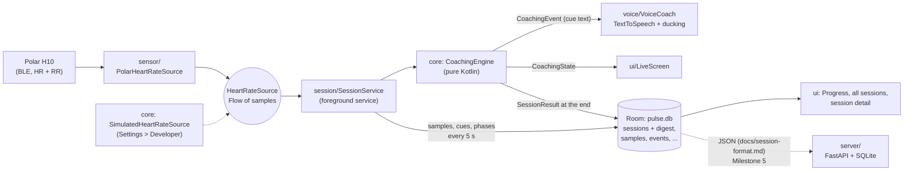

# Architecture

Pulse is two programs: the Android app (`android/`, Kotlin + Compose) and a small FastAPI
server (`server/`). The app works fully offline; the server only receives finished sessions
(upload arrives in Milestone 5).

## Data flow

- **`:core`** (pure Kotlin, JVM tests): the coaching engine, the sensor interface and the
  simulator. No Android imports, so every coaching rule is unit-tested.
- **`:app`**: `sensor` (Polar SDK, RxJava bridged to Flow only there) → `session`
  (foreground service, recorder, live HR buffer) → `data` (Room, DataStore, JSON export) →
  `ui` (Compose). `AppContainer.kt` is the whole object graph (manual DI).
- **UI pattern**: every screen is a stateless `*Content` composable fed plain values
  (`ui/DashboardModels.kt`, unit-tested), plus a thin `*Screen` that collects Flows from
  `AppContainer`. Navigation is a few lines of state in `ui/PulseApp.kt` (three tabs and a
  small back stack), no navigation library.
- **History**: each `sessions` row carries a digest (avg/max HR, time in zone, HRR60,
  drift, a 48-point sparkline) written when the session is saved, so Progress and the lists
  never read samples. The detail screen loads one session and rebuilds its `SessionResult`.

## Where to change X

| I want to... | Change |
|---|---|
| Change a coaching threshold, protocol default or zone default | `android/core/.../coaching/CoachingConfig.kt` (the only place) |
| Change what a cue says | `android/core/.../coaching/Cues.kt` |
| Add a workout mode | `SessionMode` in `CoachingModels.kt`, the engine (`CoachingEngine.kt`) and its tests, then the mode toggle in `ui/TrainContent.kt` |
| Change zones for myself | In the app: Settings > Workout (stored in DataStore, `data/settings/AppSettings.kt`) |
| Change an app-side number (flush interval, low-battery level, hold-to-end time, Progress window, list length) | `android/app/.../AppConstants.kt` |
| Change voice timing (stale cues, ducking hold) | `android/app/.../voice/VoiceConstants.kt` |
| Change a settings limit (age, minutes, zone %) | companion object of `data/settings/AppSettings.kt` |
| Change a screen | its `*Content.kt` in `ui/`; the numbers it shows come from `ui/DashboardModels.kt` |
| Change colors or fonts | `ui/theme/Theme.kt` |
| Change the database | entity in `data/db/Entities.kt`, bump the version in `PulseDatabase.kt`, add a migration in `Migrations.kt`, test it in `MigrationTest`, commit the new `app/schemas/.../N.json` |
| Change the upload format | `docs/session-format.md`, `data/export/SessionDocument.kt`, the server's `models.py` |

## Checks

`cd android && ./gradlew :core:check :app:assembleDebug :app:lintDebug :app:testDebugUnitTest`
runs everything (engine, Room on Robolectric, migrations, UI models). Screenshots of the
real screens: `./gradlew :app:recordRoborazziDebug --tests '*DesignMockups*'`.
